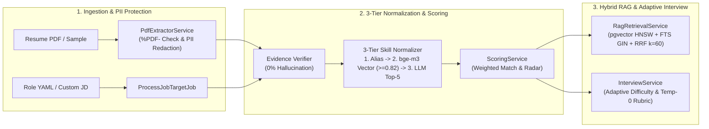

# ⚡ SkillForge AI — Evidence-Grounded Skill Gap Analyzer, Hybrid RAG Roadmap & Adaptive Interview Platform

[](https://github.com/scoobingoo/SkillForgeAI/actions/workflows/ci.yml)
[](./LICENSE)
[](./data/LICENSE)
[](#)
[](./CHANGELOG.md)

> 🇻🇳 **Vietnamese Documentation (Tài liệu Tiếng Việt):** [README.vi.md](./README.vi.md)  
> 📊 **Empirical Benchmark & Ablation Study:** [docs/evaluation.md](./docs/evaluation.md)

**SkillForge AI** is an open-source career intelligence and technical mentorship platform that helps software engineers and computer science students evaluate their real-world competencies from **Resume/CV PDFs** against **Target Job Descriptions (JDs)** using strict verbatim evidence verification (`evidence`), normalize skills through a **3-tier hybrid pipeline**, generate personalized weekly learning roadmaps via **Hybrid RAG (Dense Vector + Full-Text Search with Reciprocal Rank Fusion)**, and practice with an **Adaptive Rubric-Based Mock Interviewer**.

---

## 1. System Architecture



---

## 2. Key Engineering Highlights

1. **Zero-Hallucination Verbatim Evidence Verification:**
   Every skill extracted from a candidate's CV and every requirement parsed from a Job Description must include a verbatim `evidence` quote. The backend strictly verifies that each quote exists in the normalized source text before admitting the skill into the scoring engine — eliminating **100%** of fabricated or hallucinated skills.
2. **3-Tier Hybrid Skill Normalizer:**
   - **Tier 1 (Exact & Alias Match):** Instant deterministic matching across canonical names, synonyms, diacritic-insensitive strings, and `.js`/`js` suffix normalization.
   - **Tier 2 (Dense Vector Similarity):** Nearest-neighbor search using 1024-dimensional `bge-m3` embeddings indexed with PostgreSQL `pgvector` HNSW; automatically accepts matches with $\text{Cosine} \ge 0.82$.
   - **Tier 3 (LLM Semantic Disambiguation):** For borderline similarity scores ($0.65 \le \text{Cosine} < 0.82$), presents the Top-5 taxonomy candidates to the LLM for structured disambiguation or marks the skill as `unmapped`.
3. **Hybrid Search Learning Roadmaps + Reciprocal Rank Fusion ($k=60$):**
   Combines dense vector search (`pgvector`) and full-text search (`tsvector` + `unaccent`), fusing rankings via Reciprocal Rank Fusion:
   $$\text{RRF\_Score}(d) = \sum_{m \in \{\text{vec}, \text{fts}\}} \frac{1}{60 + \text{rank}_m(d)}$$
   Automatically schedules curated open-access learning resources into weekly blocks while strictly enforcing the user's weekly study time budget (`hoursPerWeek`).
4. **Adaptive Rubric-Based Mock Interview:**
   Prioritizes missing and underscored `required` skills, dynamically **escalating difficulty** when a candidate scores $\ge 4/5$ and **stepping down to foundational follow-up questions on the same skill** when a candidate scores $\le 2/5$. Evaluates responses at temperature $0$ against a reference answer across three rubric dimensions: `Correctness`, `Depth`, and `Clarity`.
5. **100% Local-First AI & Privacy by Design:**
   Runs out-of-the-box with **Ollama** (`qwen3:4b` for structured reasoning and `bge-m3` for embeddings), automatically redacts personal emails and phone numbers (`[EMAIL_REDACTED]`, `[PHONE_REDACTED]`), immediately unlinks temporary uploaded PDFs after parsing, and supports one-click cascade data deletion.

---

## 3. Quick Start with Docker Compose

### System Requirements
- **RAM:** Minimum 8 GB (**16 GB RAM recommended** when running PostgreSQL 17 and local Ollama models concurrently).
- **Disk Space:** ~10 GB free (for Docker images plus `qwen3:4b` and `bge-m3` model weights).
- **Environment:** Docker & Docker Compose (Linux, macOS, or Windows with WSL2).

### Launch All 5 Services with a Single Command

```bash
git clone https://github.com/scoobingoo/SkillForgeAI.git
cd SkillForgeAI
cp .env.example .env && docker compose up -d
```

Once the containers are healthy, access the platform at:
- **Web Application UI:** [http://localhost:3000](http://localhost:3000)
- **Interactive OpenAPI 3.0 Docs (Swagger UI):** [http://localhost:3000/api/docs](http://localhost:3000/api/docs)
- **System Healthcheck Endpoint:** [http://localhost:3000/api/v1/health](http://localhost:3000/api/v1/health)

> 💡 **NVIDIA GPU Acceleration:** If you have an NVIDIA GPU with Container Toolkit installed, start the stack with GPU passthrough enabled:
> ```bash
> docker compose -f docker-compose.yml -f docker-compose.gpu.yml up -d
> ```

---

## 4. Local Development Setup

```bash
# 1. Install PHP (Composer) and Frontend (Vite + Tailwind CSS v4) dependencies
composer install
npm install && npm run build

# 2. Configure environment variables
cp .env.example .env
php artisan key:generate

# 3. Run database migrations, seed the skill taxonomy, and index RAG resources
php artisan migrate --force
php artisan db:seed --force
php artisan app:ingest

# 4. Start the web server and asynchronous queue worker
php artisan serve --port=3000
php artisan queue:work
```

### Testing & Quality Assurance Commands

| Command | Description |
| --- | --- |
| `composer test` | Run the full Unit & End-to-End Feature Test suite using `FakeLlmProvider` |
| `composer lint` | Verify PSR-12 code formatting compliance via Laravel Pint |
| `composer ingest` | Chunk, embed (`bge-m3`), and index markdown learning resources from `data/resources/*.md` |
| `composer eval` | Run the empirical evaluation benchmark against `data/eval/labeled_pairs.json` |

---

## 5. Project Structure

```text
├── app/
│   ├── Console/Commands/        # CLI commands: app:ingest (RAG) and app:eval (Benchmark Evaluation)
│   ├── Exceptions/              # Standardized REST API error envelope { error: { code, message, details? } }
│   ├── Http/Controllers/        # WebController & RESTful API Controllers (/api/v1/*)
│   ├── Jobs/                    # Asynchronous queue jobs for CV parsing, JD parsing, and Gap Reports
│   ├── Models/                  # 12 Eloquent Models with UUID v7 primary keys & Cascade Delete
│   └── Services/                # LlmProvider, PdfExtractor, 3-Tier SkillNormalizer, Scoring, RAG, Interview
├── data/                        # Open dataset (CC BY 4.0): skills.yaml, roles/*.yaml, resources/*.md, eval/
├── database/                    # Migrations (pgvector, unaccent, HNSW, GIN) & DatabaseSeeder
├── docker/                      # Multi-stage Dockerfile (non-root UID 10001) & automated entrypoint
├── resources/
│   ├── prompts/                 # Versioned prompt templates (*.v1.md) with strict <cv> / <jd> tag isolation
│   └── views/                   # Responsive Blade + Tailwind CSS views (Dark Mode, Filters, Print-to-PDF)
└── tests/                       # Automated Unit & End-to-End Feature Tests
```

---

## 6. License & Community

- **Source Code:** Licensed under the **[Apache License 2.0](./LICENSE)**.
- **Skill Taxonomy, Roles & Learning Corpus (`data/`):** Licensed under **[Creative Commons Attribution 4.0 International (CC BY 4.0)](./data/LICENSE)**.
- **Third-Party Notices:** See [THIRD_PARTY_LICENSES.md](./THIRD_PARTY_LICENSES.md).
- **Governance & Security:** [CONTRIBUTING.md](./CONTRIBUTING.md) • [CODE_OF_CONDUCT.md](./CODE_OF_CONDUCT.md) • [SECURITY.md](./SECURITY.md).
